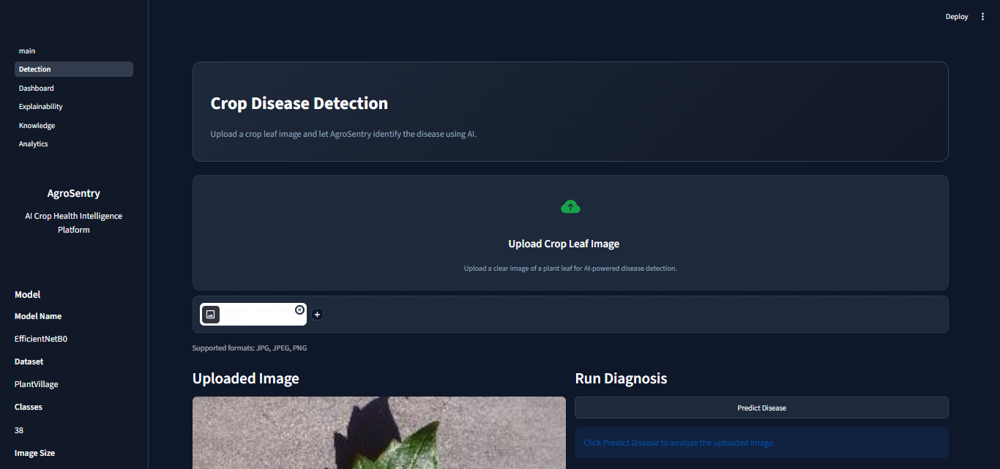
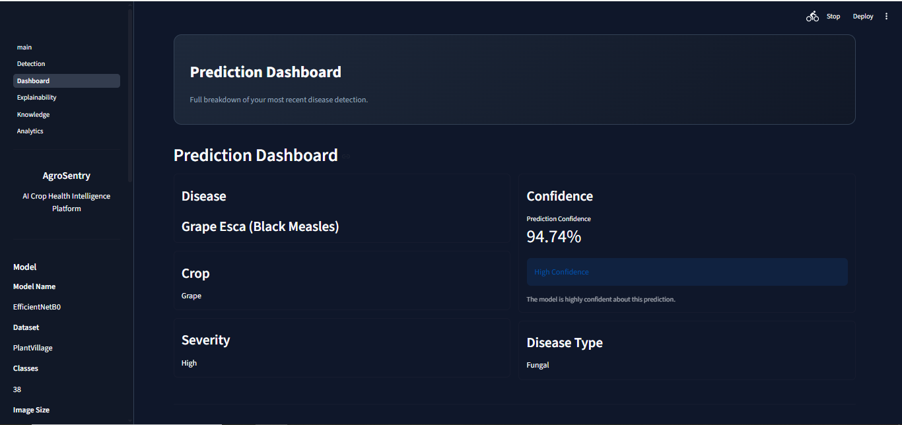
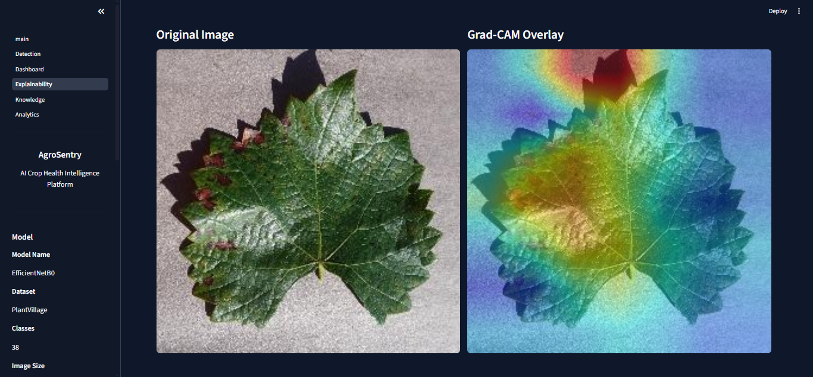
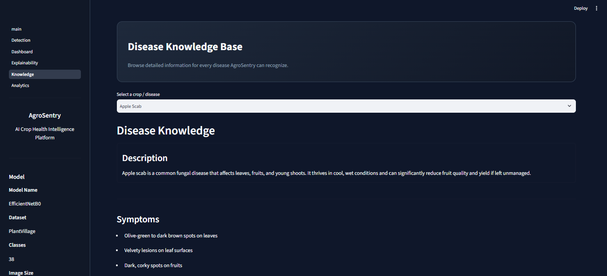
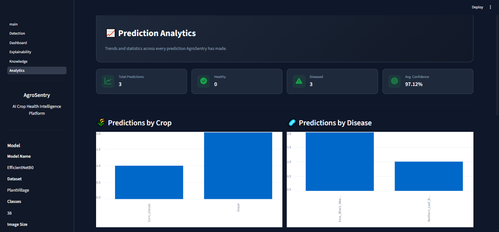
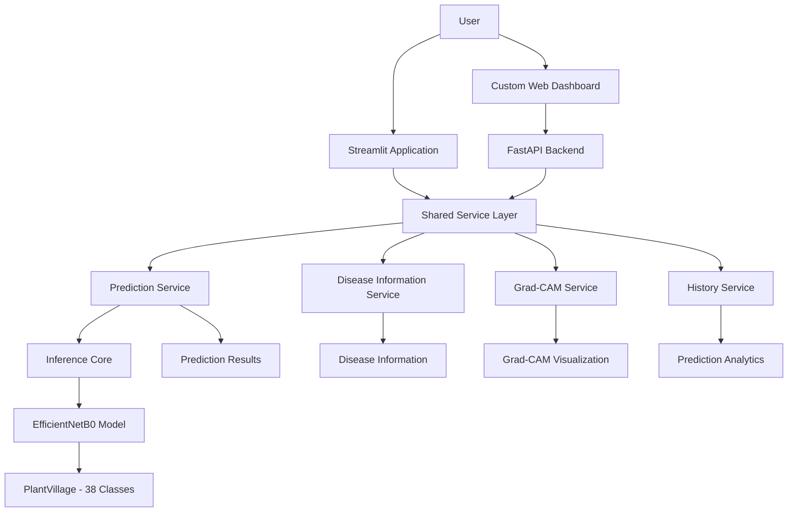

#  AgroSentry
###  AgroSentry Banner


---
### AI-Powered Crop Health Intelligence Platform

AgroSentry is an AI-powered crop disease detection platform that combines **Deep Learning, Grad-CAM Explainable AI, and Disease Analytics** to help identify plant diseases from leaf images.

Built using a fine-tuned EfficientNetB0 model trained on the PlantVillage dataset, AgroSentry provides disease predictions, confidence scores, visual explanations, treatment recommendations, and prediction analytics through two interfaces: a Streamlit application and a FastAPI-powered web dashboard.
---

##  Table of Contents

- [Overview](#-overview)
- [Features](#-features)
- [Screenshots](#-screenshots)
- [System Architecture](#-system-architecture)
- [Technology Stack](#-technology-stack)
- [Project Structure](#-project-structure)
- [Installation](#-installation)
- [Running the Application](#-running-the-application)
- [API Documentation](#-api-documentation)
- [Model Information](#-model-information)
- [Future Enhancements](#-future-enhancements)
- [License](#-license)

---

## 🌾 Overview

Crop diseases can significantly affect agricultural productivity. Early identification helps farmers take appropriate preventive and treatment measures.

AgroSentry addresses this challenge using deep learning-based image classification. Users can upload a plant leaf image and receive a predicted disease, confidence score, Grad-CAM visualization, and relevant disease information.

The platform includes two application interfaces that share a common inference and service layer:

1. **Streamlit Application** – A multi-page interactive application.
2. **FastAPI Web Dashboard** – A custom HTML, CSS, and JavaScript interface backed by REST APIs.

---

##  Features

###  AI-Based Disease Detection
- Fine-tuned EfficientNetB0 deep learning model.
- Supports classification across 38 plant disease classes.
- Leaf image preprocessing and prediction.
- Prediction confidence and class probabilities.

###  Explainable AI
- Grad-CAM-based visual explanations.
- Highlights image regions influencing the model's prediction.
- Helps users understand model attention.

###  Disease Knowledge Base
- Disease symptoms and descriptions.
- Treatment recommendations.
- Organic and chemical control information.
- Prevention methods and farmer tips.

###  Disease Analytics
- Prediction history tracking.
- Disease statistics and analytics dashboard.
- Historical prediction visualization.

### Multiple Interfaces
- Streamlit multi-page application.
- FastAPI backend with a custom web dashboard.
- Shared inference and service components.

---


## Project Screenshots

### 1. Disease Detection



### 2. Dashboard



### 3. Explainable AI – Grad-CAM



### 4. Disease Knowledge Base



### 5. Prediction Analytics




| Module | Screenshot |
|---|---|
| Disease Detection | `docs/screenshot-detection.png` |
| Dashboard | `docs/screenshot-dashboard.png` |
| Explainability | `docs/screenshot-explainability.png` |
| Disease Knowledge | `docs/screenshot-knowledge.png` |
| Analytics | `docs/screenshot-analytics.png` |

<!-- Add screenshots using the filenames above, or replace them with your actual filenames. -->

---

##  System Architecture



---

##  Technology Stack

| Category | Technologies |
|---|---|
| Programming Language | Python 3.13 |
| Deep Learning | TensorFlow, Keras |
| Model Architecture | EfficientNetB0 |
| Explainable AI | Grad-CAM |
| Dataset | PlantVillage |
| Web Application | Streamlit |
| Backend | FastAPI |
| ASGI Server | Uvicorn |
| Frontend | HTML, CSS, JavaScript |
| Data Processing | NumPy, Pandas |
| Image Processing | OpenCV, Pillow |
| Machine Learning Utilities | Scikit-learn |

---

##  Project Structure

```text
AgroSentry/
│
├── assets/
│   └── theme.css
│
├── components/
│   ├── hero.py
│   ├── metric_card.py
│   ├── upload_card.py
│   ├── prediction_card.py
│   ├── disease_card.py
│   └── sidebar.py
│
├── data/
│   ├── class_names.json
│   └── disease_info.json
│
├── docs/
│   ├── banner.png
│   └── screenshots...
│
├── frontend/
│   └── leaf-scan-dashboard.html
│
├── models/
│   └── best_model.keras
│
├── notebooks/
│
├── outputs/
│   └── history.csv
│
├── pages/
│   ├── 1_Detection.py
│   ├── 2_Dashboard.py
│   ├── 3_Explainability.py
│   ├── 4_Knowledge.py
│   └── 5_Analytics.py
│
├── src/
│   ├── inference/
│   ├── services/
│   └── ui/
│
├── app.py
├── main.py
├── config.py
├── requirements.txt
├── .gitignore
└── README.md
```

---

##  Installation

### 1. Clone the Repository

```bash
git clone https://github.com/YOUR_USERNAME/AgroSentry.git
cd AgroSentry
```

### 2. Create a Virtual Environment

**Windows:**

```powershell
python -m venv .venv
.venv\Scripts\activate
```

**Linux / macOS:**

```bash
python3 -m venv .venv
source .venv/bin/activate
```

### 3. Install Dependencies

```bash
pip install --upgrade pip
pip install -r requirements.txt
```

---

## 🚀 Running the Application

AgroSentry provides two ways to access the platform.

### Option 1: Streamlit Application

Run:

```bash
streamlit run main.py
```

Open in your browser:

```text
http://localhost:8501
```

### Option 2: FastAPI Web Dashboard

Run:

```bash
uvicorn app:app --reload --host 0.0.0.0 --port 8000
```

Open the dashboard:

```text
http://localhost:8000
```

FastAPI Swagger documentation:

```text
http://localhost:8000/docs
```

---

## API Documentation

The FastAPI backend exposes REST endpoints for prediction and analytics.

### 1. Disease Prediction

**Endpoint:**

```http
POST /predict
```

**Request:** Multipart form-data with an image field named `image`.

**Example response:**

```json
{
  "predicted_class": "Tomato___Early_blight",
  "confidence": 0.95,
  "predictions": [],
  "disease_info": {}
}
```

The response structure is illustrative; actual fields depend on the backend implementation.

### 2. Prediction History

```http
GET /history
```

Retrieves recorded prediction history.

### 3. Prediction Statistics

```http
GET /stats
```

Retrieves prediction analytics and statistics.

### 4. API Documentation

```text
GET /docs
```

Provides interactive Swagger UI documentation.

---

##  Model Information

| Property | Details |
|---|---|
| Model Architecture | EfficientNetB0 |
| Learning Approach | Transfer Learning / Fine-Tuning |
| Dataset | PlantVillage |
| Number of Classes | 38 |
| Input Image Size | 224 × 224 |
| Model File | `models/best_model.keras` |
| Explainability | Grad-CAM |

The trained model classifies plant leaf images into supported disease categories. Grad-CAM provides visual explanations of regions influencing predictions.

**Note:** Predictions are intended as decision-support information and should not replace expert agricultural diagnosis. Performance on real-world field images may differ from performance on the training dataset.

---

##  Future Enhancements

- Real-world field image validation and robustness improvements.
- User-specific prediction history.
- Batch image prediction.
- Automated testing and model evaluation.
- Cloud deployment and production monitoring.
- Expanded crop and disease coverage.

---

##  License

This project is licensed under the **MIT License**.

You are free to use, modify, and distribute this software, subject to the conditions of the MIT License.

See the [LICENSE](LICENSE) file for details.

---

##  Author

**Suchendra A**

AgroSentry – AI-Powered Crop Health Intelligence Platform.

GitHub: [YOUR_GITHUB_PROFILE](https://github.com/Suchendra-018)

---

<p align="center">
  <b>AgroSentry — Smarter Crop Health Through AI</b>
</p>